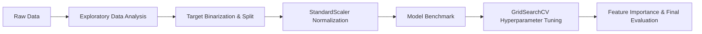

# 🍷 Wine Quality Prediction using Machine Learning

[](https://www.python.org/)
[](https://scikit-learn.org/)
[](https://pandas.pydata.org/)
[](https://opensource.org/licenses/MIT)

An end-to-end Machine Learning classification project that predicts wine quality based on physicochemical properties. The project explores the effect of feature scaling, benchmarks multiple machine learning algorithms on imbalanced data, performs hyperparameter optimization using `GridSearchCV`, and examines feature importance.

---

## 📌 Project Overview

- **Problem Type:** Binary Classification (Class Imbalance)
- **Target Definition:**
  - `GOOD` Quality (`1`): Wine rating $\ge 7$
  - `BAD` Quality (`0`): Wine rating $< 7$
- **Dataset:** 1,599 red wine samples evaluated across 11 physicochemical attributes.
- **Core Focus:**
  - Robust handling of **class imbalance** (evaluating models primarily on **F1-Score** rather than misleading raw accuracy).
  - Comparing **unscaled vs. scaled** data representation on linear models.
  - Multi-model evaluation (**Logistic Regression**, **k-Nearest Neighbors**, and **Decision Tree**).
  - Systematic hyperparameter tuning with 5-fold cross-validation.
  - Interpretability and feature importance analysis.

---

## 📊 Dataset & Features

The dataset comprises 11 independent chemical measurements and 1 target rating:

| Feature | Description |
| :--- | :--- |
| `fixed acidity` | Non-volatile acids involved with wine taste |
| `volatile acidity` | Acetic acid quantity (high levels lead to vinegar taste) |
| `citric acid` | Imparts freshness and flavor |
| `residual sugar` | Sugar remaining after fermentation ceases |
| `chlorides` | Salt quantity in wine |
| `free sulfur dioxide` | Free form of $\text{SO}_2$ preventing microbial growth & oxidation |
| `total sulfur dioxide` | Sum of free and bound forms of $\text{SO}_2$ |
| `density` | Density of wine (closely related to alcohol and sugar content) |
| `pH` | Wine acidity level on a 0-14 scale |
| `sulphates` | Antimicrobial and antioxidant additive |
| `alcohol` | Percent alcohol content by volume |
| **`quality`** | Target sensory score between 0 and 10 |

---

## 🔬 Machine Learning Pipeline



1. **Exploratory Data Analysis (EDA):**
   - Verified zero missing values across all columns.
   - Identified strong correlations: `alcohol` exhibits the highest positive correlation with quality ($r \approx 0.48$), while `volatile acidity` has the highest negative correlation ($r \approx -0.39$).
2. **Preprocessing & Target Encoding:**
   - Created binary target `quality_label` ($1$ if `quality` $\ge 7$, else $0$).
   - Train/Test Split (80/20) with stratified random state.
3. **Feature Scaling:**
   - Normalized features using `StandardScaler` to evaluate distance-sensitive models.
4. **Model Comparison:**
   - Evaluated Logistic Regression, k-Nearest Neighbors (KNN), and Decision Tree Classifier.
5. **Hyperparameter Tuning:**
   - Applied `GridSearchCV` on the winning baseline architecture to optimize criterion, tree depth, and splitting parameters.
6. **Feature Importance:**
   - Computed Gini/Entropy importance to identify key drivers of quality.

---

## 📈 Experimental Results

### 1. Effect of Feature Scaling (Logistic Regression)

| Model Configuration | Accuracy | Precision | Recall | F1-Score |
| :--- | :---: | :---: | :---: | :---: |
| Logistic Regression (Unscaled) | 89.38% | 73.68% | 32.56% | 0.4516 |
| **Logistic Regression (StandardScaler)** | **89.38%** | **69.57%** | **37.21%** | **0.4848** |

> **Key Takeaway:** Scaling improved convergence and boosted recall on the minority class, lifting the F1-score from **0.4516** to **0.4848**.

---

### 2. Multi-Model Benchmark

| Classifier | Accuracy | Precision | Recall | F1-Score |
| :--- | :---: | :---: | :---: | :---: |
| Logistic Regression | 89.38% | 69.57% | 37.21% | 0.4848 |
| k-Nearest Neighbors ($k=5$) | 89.38% | 66.67% | 41.86% | 0.5143 |
| **Decision Tree (Baseline)** | **90.62%** | **63.83%** | **69.77%** | **0.6667** |

---

### 3. Hyperparameter Optimization & Final Performance

The Decision Tree model was tuned with 5-fold cross-validation using `GridSearchCV`:
- **Optimal Parameters:** `{'criterion': 'entropy', 'max_depth': None, 'min_samples_leaf': 1, 'min_samples_split': 2}`

| Model | Accuracy | Precision | Recall | F1-Score |
| :--- | :---: | :---: | :---: | :---: |
| Decision Tree (Default) | 90.62% | 63.83% | 69.77% | 0.6667 |
| **Decision Tree (Tuned)** | **92.50%** | **73.17%** | **69.77%** | **0.7143** |

> **Result:** Tuning lifted overall accuracy to **92.50%**, precision to **73.17%**, and achieved a peak F1-Score of **0.7143**.

---

## 🔑 Key Feature Importances

Top chemical factors driving classification in the tuned model:

1. **Alcohol (28.6%):** Strongest positive predictor of higher wine ratings.
2. **Sulphates (10.2%):** Critical preservative contributing to preservation and taste stability.
3. **Volatile Acidity (9.7%):** Strongest inhibitor; excessive volatile acid causes unpleasant sourness.
4. **pH (8.7%)** & **Total Sulfur Dioxide (7.9%)**: Key chemical balance markers.

---

## 📁 Repository Structure

```text
WineQuality/
├── Wine_Quality_ML_Project.ipynb   # Complete Jupyter Notebook with code & visualizations
├── winequality.csv                 # Wine quality dataset (UCI ML Repository)
├── requirements.txt                # Python environment dependencies
├── .gitignore                      # Git ignore file for Python/Jupyter
└── README.md                       # Project documentation and findings
```

---

## 🚀 Getting Started

### Prerequisites

- Python 3.9+
- pip package manager

### Installation

1. **Clone the repository:**
   ```bash
   git clone https://github.com/jaywardhanjagtap/Wine_Quality.git
   cd Wine_Quality
   ```

2. **Create and activate a virtual environment (optional but recommended):**
   ```bash
   # Windows
   python -m venv venv
   .\venv\Scripts\activate

   # macOS / Linux
   python3 -m venv venv
   source venv/bin/activate
   ```

3. **Install dependencies:**
   ```bash
   pip install -r requirements.txt
   ```

4. **Launch the notebook:**
   ```bash
   jupyter notebook Wine_Quality_ML_Project.ipynb
   ```

---

## 🔮 Future Improvements

- [ ] Implement ensemble models (Random Forest, XGBoost, LightGBM) to push F1-score higher.
- [ ] Implement SMOTE (Synthetic Minority Over-sampling Technique) or cost-sensitive learning (`class_weight='balanced'`) to address minority class representation.
- [ ] Deploy the best model as an interactive web API using **FastAPI** or **Streamlit**.

---

## 📜 License

This project is licensed under the MIT License - see the [LICENSE](LICENSE) file for details.
